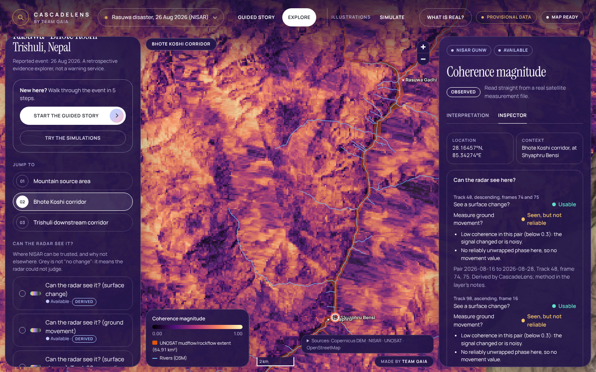

# GAIA CascadeLens

**Following change on Earth's surface, one radar observation at a time.**

GAIA: Seeing Earth Dance. A Team GAIA project for NASA Space Apps Challenge 2026, Dancing with the SARs.

CascadeLens is a retrospective evidence explorer for the 26 August 2026 Rasuwa–Bhote Koshi–Trishuli disaster in Nepal, with a second case on the Tsho Rolpa glacial lake. It is designed to put NISAR radar measurements on a map with their quality, provenance and limits in view. It is not a warning system.

> **Data status: real NISAR measurements are loaded.** For Rasuwa, Pair A (GUNW and GOFF, Track 48 descending) and Pair B (GUNW and GOFF, Track 98 ascending, the opposite side) passed QA. Tsho Rolpa uses GCOV on four dates; Rasuwa GCOV is not downloaded. All products are Provisional. No displacement is calculated anywhere.
>
> **Rebuilt on 13 November 2026** from the raw NISAR files, with the corrected method: the product's own quality mask is applied, frames 74 and 75 are both assessed, and the before/after comparison is reproducible from the repository. The first observability method, which ignored the mask, is withdrawn. See [IMPLEMENTATION_STATUS.md](IMPLEMENTATION_STATUS.md) and [docs/RADAR_OBSERVABILITY.md](docs/RADAR_OBSERVABILITY.md).



## Quick start

Online: open https://ak-gurung09.github.io/CASCADE-LENS-/ in a desktop browser. It is the same app and data, rebuilt from `main` by [.github/workflows/pages.yml](.github/workflows/pages.yml) on every change. It loads map data as you explore (the whole site is about 365 MB), so a fast connection helps.

Offline: use the finished package, `CascadeLens.zip`. Unzip it to a short path and double-click **Start CascadeLens.bat**. On macOS or Linux, open a terminal in the unzipped folder and run `sh start.sh` instead. It needs no internet connection. On Windows it needs nothing installed: the launcher uses Python 3 when it is there, and Windows' own PowerShell when it is not. On macOS or Linux it needs Python 3. To use Brave or another browser, paste the address from the black window.

Do not open `index.html` directly. Browsers block a page opened that way from loading its scripts and data, so it cannot start.

## What the radar shows

- **Coherence** is much lower along the UNOSAT-mapped channel than on the terrain beside it: 0.19 against 0.46 in frame 74, and 0.16 against 0.52 in frame 75. Only pixels the product marks valid count, which is 37% and 44% of the mapped extent.
- **At the source**, Pair A holds no usable measurement. The product's own mask gives every detachment-zone pixel the value 10: not water, but no valid subswath in the 28 August acquisition. It is a gap in that acquisition's coverage. Pair B, from the opposite side, does reach the source. Its coherence there is very low (median 0.09 against 0.46 on terrain near the channel), and image matching largely fails (correlation peak 0.18 against 0.63). Ground movement cannot be measured there from either side.
- **Before and after.** In the pair before the event, the mapped mudflow and the ground around it had similar median coherence (0.38 against 0.40). Across the event, coherence fell to 0.19 inside the mapped area while the ground around it rose to 0.50, and in that pair the 95% intervals of the two medians do not overlap. That is consistent with surface change there, but it does not establish the cause. The pairs are not like for like: the pair before spans 24 days and the event pair 12, and they were acquired in different radar modes (4000 and 2000 in the file names). From the opposite side (Track 98), where every pair has the same radar mode, the gap also opens across the event: 0.31 against 0.40 before, 0.13 against 0.49 across.
- **Raw phase** is dominated by the ionosphere. Removing the product's own estimate cuts scatter by about half to two-thirds.
- **Pixel offsets** show no large coherent shift. They come from the product layer with the smallest search window, which could miss a very large shift.

This is evidence to examine, not proof of cause. See [SCIENTIFIC_VALIDATION.md](docs/SCIENTIFIC_VALIDATION.md).

## What works today

- Interactive offline map with Copernicus DEM terrain, UNOSAT event layers, Sentinel-1 damage evidence, OSM geography and district boundaries.
- Two cases: Rasuwa, which opens first, and the Tsho Rolpa glacial lake, which has GCOV lake area on four dates, a before/after swipe, a 3D terrain view and a labelled what-if dam-break scenario.
- Geographic bookmarks and a guided story for each case. Every figure in the story is read from the shipped data, so the story cannot claim a result that is not loaded.
- A Simulate mode with a flow replay along the rivers, a what-if flood and a radar explainer. All three are labelled illustrations, and they are not forecasts.
- Real NISAR phase, coherence, connected components, ionosphere screen and pixel offsets, with a labelled ionosphere-removed phase layer.
- Observation-pair selection, with dates, tracks and frames verified from the files.
- A measurement inspector that reads stored raster values, with quality alongside.
- An evidence class on every layer, panel and report: Observed, Derived, Forecast, Hypothesis, Reference, Scenario or Unknown.
- Radar observability (“Can the radar see it?”): for each spot, whether a surface change could be judged and whether movement could be measured, with the reasons kept separate, from two viewing directions judged on their own: Track 48 (frames 74 and 75) and Track 98 (frame 16). At the detachment zone Track 48 holds no valid data; Track 98 can judge a change on 35% of it, and neither can measure movement there.
- Coherence through time: five Track 48 pairs over frames 74 and 75 (23 July to 3 October 2026) and five Track 98 pairs (26 July to 6 October), one layer each, so the inspector shows a clicked spot pair by pair, downstream to the Trishuli as well.
- “What could explain this?”, a rule-based panel that lists the checks for and against each explanation and never gives a probability, and an evidence report as a printable page, CSV, GeoJSON or JSON.
- Experimental hazard screens: landslide-prone terrain and road exposure along the Rasuwa corridor. Each 250 m road stretch has a stable ID, and its evidence panel shows the rating, what the radar saw there from each viewing direction, from which file, and what to verify next. Every report format carries the same record.
- A field-check list. Any screened road stretch can become a record that keeps its satellite evidence, what it cannot tell, and what to check. People add dated field reports with a source, and only those can mark a record Verified or Not confirmed. Records stay in the browser they were made in, and export as a printable brief, CSV, GeoJSON or JSON. Exposure is never shown as damage or closure.
- "What to try next" for any clicked spot the radar cannot use: fixed, named rules that say whether the next piece of evidence is already loaded, only catalogued, not found, or needs a person.
- An experimental road access screen: which named places keep a road path to a health facility once roads OSM maps as destroyed and bridges reported washed out are closed, and which closures cause each loss. See [docs/ACCESS_SCREEN.md](docs/ACCESS_SCREEN.md).
- A readiness engine that records, from the files on disk, how far each flood and landslide capability could honestly go and what it needs next. Today none goes beyond context or raw data, so nothing is forecast. See [docs/READINESS.md](docs/READINESS.md).
- First model code (rainfall thresholds, logistic-regression susceptibility, the GR4J river model) and a verification harness (POD, FAR, CSI, chronological splits, a leakage guard). The rainfall threshold was run on real data (IMERG Late rainfall and BIPAD landslide reports, 2016 to 2026) and did not beat chance in the held-out years, so no landslide warning is offered. See [docs/MODELS.md](docs/MODELS.md).
- Layer statuses generated from the files on disk. A NISAR layer cannot be selected until it has been downloaded, inspected and passed QA.
- A list of what is real (“What is real?”), read from `frontend/public/data/status.json`, which gives each capability its maturity. Each headline claim is listed in `frontend/public/data/claims.json` with its basis and status, and a test keeps withdrawn claims out of the app and the main docs.
- A Python pipeline for GUNW, GOFF and GCOV, with QA gates and provenance.
- A pre-download QA check, and a clearly labelled browse-preview fallback.
- Automated tests at every level, including real browser tests with offline and accessibility checks.

## The retired LANDMET test case

LANDMET, a global land weather dataset from 31 December 2007, was once a third case that showed the product could load data it was not designed for. The team took it out of the app on 6 November 2026. Its processing script and pipeline tests remain in the repository, but the case selector no longer offers it. It was never NISAR data and said nothing about Rasuwa.

## Architecture

```text
ASF / Earthdata  ->  Python pipeline (inspect, QA, clip)  ->  COGs, PNG tiles, GeoJSON, manifest.json
                                                                        |
                                              React + MapLibre + geotiff.js (static, no backend)
```

Scientific processing happens before the browser. See [docs/ARCHITECTURE_DECISIONS.md](docs/ARCHITECTURE_DECISIONS.md).

## Run from source

Requires Node 22 or later. The prepared data is in `frontend/public/data`.

```bash
cd frontend
```

```bash
npm install
```

```bash
npm run dev
```

Open http://localhost:5173. For the offline demonstration, which blocks all external requests:

```bash
npm run build
```

```bash
npm run preview
```

## Run the pipeline

Requires Python 3.11 or later.

```bash
python -m venv .venv
```

```bash
.venv/Scripts/python -m pip install -r processing/requirements.txt
```

On macOS or Linux, use `.venv/bin/python`. To rebuild the context layers (no login needed):

```bash
python processing/scripts/fetch_context.py
```

```bash
python processing/scripts/prepare_context.py
```

To rebuild the Simulate mode's flow path:

```bash
python processing/scripts/prepare_simulation.py
```

To add NISAR data (login needed, see [docs/DATA_ACQUISITION.md](docs/DATA_ACQUISITION.md)):

```bash
python processing/scripts/discover_products.py
```

```bash
python processing/scripts/download_products.py --qa-only
```

```bash
python processing/scripts/download_products.py
```

```bash
python processing/scripts/process_nisar.py
```

```bash
python processing/scripts/generate_manifest.py
```

## Test

Every pull request runs the type check, the unit tests, the Python tests and the browser tests, see [.github/workflows/ci.yml](.github/workflows/ci.yml).

To include the real-format tests, first fetch NASA's public samples (about 540 MB, no login):

```bash
python processing/scripts/fetch_samples.py
```

```bash
python -m pytest tests
```

```bash
cd frontend && npm test
```

Browser tests use the system Edge by default. To use another Chromium browser, set `CL_BROWSER_PATH` to its executable. Prepare the fixture and build first:

```bash
python tests/integration/build_fixture.py
```

```bash
cd frontend && npm run build && npm run e2e
```

Browser tests save their screenshots in `frontend/test-results/screenshots`, which git ignores. To refresh the pictures in `docs/screenshots` on purpose, set `CL_SCREENSHOTS_DIR=../docs/screenshots` for that run.

Some Python tests are skipped unless the raw NISAR granules, NASA's samples or the LANDMET file are present. Passing tests check the code's behaviour. They do not validate a scientific result.

To build the finished package:

```bash
python processing/scripts/build_product.py
```

To explore the NISAR path by hand, on labelled non-Rasuwa data:

```bash
python tests/integration/build_fixture.py --sample
```

```bash
cd frontend && npm run dev:fixture
```

## Known limitations

All NISAR products are Provisional, and Rasuwa GCOV is not downloaded. Phase is not converted to displacement. Offsets are radar components, not geographic vectors. UNOSAT and Sentinel-1 layers are preliminary and are not NISAR results. See [docs/LIMITATIONS.md](docs/LIMITATIONS.md).

## Documentation

[Data acquisition](docs/DATA_ACQUISITION.md) · [Road access screen](docs/ACCESS_SCREEN.md) · [Readiness](docs/READINESS.md) · [Adding data to Simulate](docs/ADDING_DATA.md) · [Data sources](docs/DATA_SOURCES.md) · [Methodology](docs/METHODOLOGY.md) · [Scientific validation](docs/SCIENTIFIC_VALIDATION.md) · [Limitations](docs/LIMITATIONS.md) · [Data schema](docs/API_AND_DATA_SCHEMA.md) · [Demonstration](docs/DEMONSTRATION.md) · [Plan](docs/IMPLEMENTATION_PLAN.md)

## Licence

Code: MIT, as a default the team can change before publishing. Bundled data keeps its own terms, including CC BY-SA for UNOSAT, ODbL for OSM and CC BY for the Sentinel-1 analyses. See [docs/DATA_SOURCES.md](docs/DATA_SOURCES.md).
