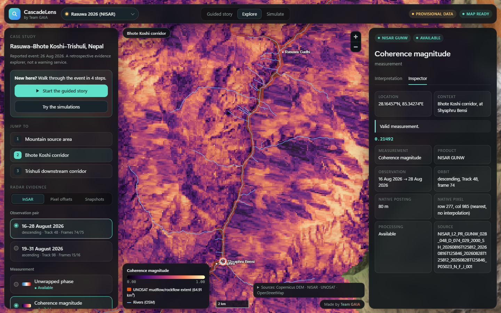
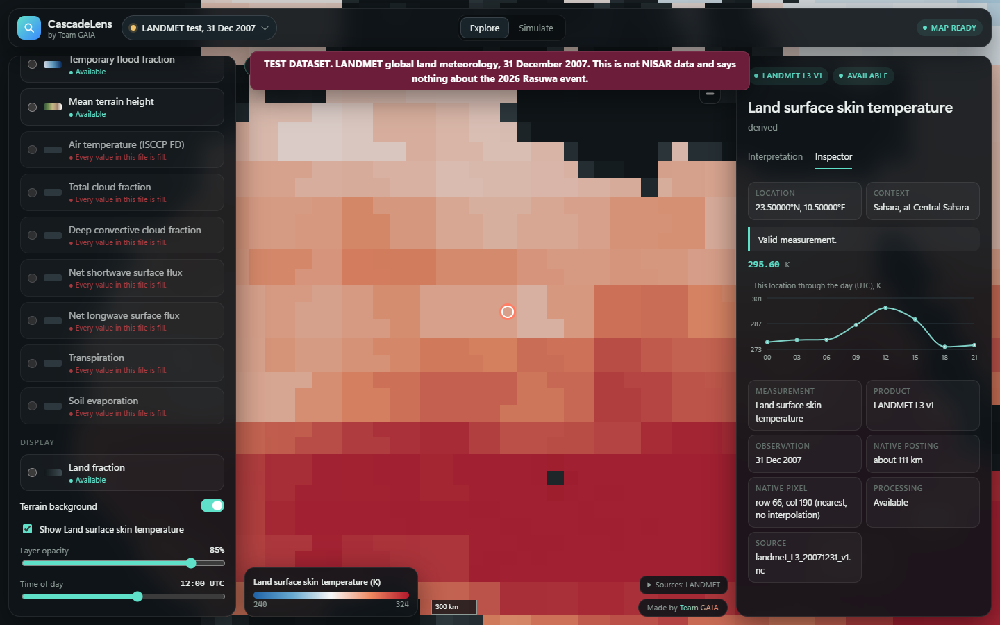

# GAIA CascadeLens

**Following Earth's movement, one radar observation at a time.**

GAIA: Seeing Earth Dance. A Team GAIA project for NASA Space Apps Challenge 2026, Dancing with the SARs.

CascadeLens is a retrospective evidence explorer for the 26 August 2026 Rasuwa–Bhote Koshi–Trishuli disaster in Nepal. It is designed to put NISAR radar measurements on a map with their quality, provenance and limits in view. It is not a warning system.

> **Data status: real NISAR measurements of the event are loaded.** Pair A (GUNW and GOFF) and Pair B (GOFF) passed QA. All are Provisional. GCOV is not downloaded. No displacement is calculated. See [IMPLEMENTATION_STATUS.md](IMPLEMENTATION_STATUS.md).



## Quick start

Use the finished package, `CascadeLens.zip`. Unzip it to a short path and double-click **Start CascadeLens.bat**. It needs Python 3 and no internet connection. To use Brave or another browser, paste the address from the black window.

Do not open `index.html` directly. Browsers block a page opened that way from loading its scripts and data, so it cannot start.

## What the radar shows

- **Coherence** is much lower along the UNOSAT-mapped channel than on the terrain beside it: 0.19 against 0.46, and 0.16 against 0.52.
- **At the source**, Pair A has no data, because it falls in a swath gap. Pair B reaches it, and image matching largely fails there: correlation peak 0.18 against 0.63.
- **Raw phase** is dominated by the ionosphere. Removing the product's own estimate cuts scatter by about half to two-thirds.
- **Pixel offsets** show no large coherent shift.

This is evidence to examine, not proof of cause. See [SCIENTIFIC_VALIDATION.md](docs/SCIENTIFIC_VALIDATION.md).

## What works today

- Interactive offline map with Copernicus DEM terrain, UNOSAT event layers, Sentinel-1 damage evidence, OSM geography and district boundaries.
- Three geographic bookmarks and a four-step guided story.
- A Simulate mode with a flow replay along the rivers, a what-if flood and a radar explainer. All three are labelled illustrations, and they are not forecasts.
- Real NISAR phase, coherence, connected components, ionosphere screen and pixel offsets, with a labelled ionosphere-removed phase layer.
- Observation-pair selection, with dates, tracks and frames verified from the files.
- A measurement inspector that reads stored raster values, with quality alongside.
- A second case study, LANDMET, proving the product works on an unrelated dataset, with a time slider and a day chart.
- Layer statuses generated from the files on disk. A NISAR layer cannot be selected until it has been downloaded, inspected and passed QA.
- A Python pipeline for GUNW, GOFF and GCOV, with QA gates and provenance.
- A pre-download QA check, and a clearly labelled browse-preview fallback.
- Automated tests at every level, including real browser tests with offline and accessibility checks.

## The LANDMET test case

Global land weather from 31 December 2007, on a coarse equal-area grid. **It is not NISAR data and says nothing about Rasuwa**, and the app says so in a permanent banner. It proves the product can load a dataset it was never designed for.



## Architecture

```text
ASF / Earthdata  ->  Python pipeline (inspect, QA, clip)  ->  COGs, PNG tiles, GeoJSON, manifest.json
                                                                        |
                                              React + MapLibre + geotiff.js (static, no backend)
```

Scientific processing happens before the browser. See [docs/ARCHITECTURE_DECISIONS.md](docs/ARCHITECTURE_DECISIONS.md).

## Run from source

Requires Node 22 or later. The prepared data is in `frontend/public/data`.

```bash
cd frontend
```

```bash
npm install
```

```bash
npm run dev
```

Open http://localhost:5173. For the offline demonstration, which blocks all external requests:

```bash
npm run build
```

```bash
npm run preview
```

## Run the pipeline

Requires Python 3.11 or later.

```bash
python -m venv .venv
```

```bash
.venv/Scripts/python -m pip install -r processing/requirements.txt
```

On macOS or Linux, use `.venv/bin/python`. To rebuild the context layers (no login needed):

```bash
python processing/scripts/fetch_context.py
```

```bash
python processing/scripts/prepare_context.py
```

To rebuild the Simulate mode's flow path:

```bash
python processing/scripts/prepare_simulation.py
```

To add NISAR data (login needed, see [docs/DATA_ACQUISITION.md](docs/DATA_ACQUISITION.md)):

```bash
python processing/scripts/discover_products.py
```

```bash
python processing/scripts/download_products.py --qa-only
```

```bash
python processing/scripts/download_products.py
```

```bash
python processing/scripts/process_nisar.py
```

```bash
python processing/scripts/generate_manifest.py
```

## Test

To include the real-format tests, first fetch NASA's public samples (about 540 MB, no login):

```bash
python processing/scripts/fetch_samples.py
```

```bash
python -m pytest tests
```

```bash
cd frontend && npm test
```

Browser tests use the system Edge. Prepare the fixture and build first:

```bash
python tests/integration/build_fixture.py
```

```bash
cd frontend && npm run build && npm run e2e
```

To rebuild the LANDMET case:

```bash
python processing/scripts/prepare_landmet.py path/to/landmet_L3_20071231_v1.nc
```

To build the finished package:

```bash
python processing/scripts/build_product.py
```

To explore the NISAR path by hand, on labelled non-Rasuwa data:

```bash
python tests/integration/build_fixture.py --sample
```

```bash
cd frontend && npm run dev:fixture
```

## Known limitations

All NISAR products are Provisional, and GCOV is not downloaded. Phase is not converted to displacement. Offsets are radar components, not geographic vectors. UNOSAT and Sentinel-1 layers are preliminary and are not NISAR results. See [docs/LIMITATIONS.md](docs/LIMITATIONS.md).

## Documentation

[Data acquisition](docs/DATA_ACQUISITION.md) · [Adding data to Simulate](docs/ADDING_DATA.md) · [Data sources](docs/DATA_SOURCES.md) · [Methodology](docs/METHODOLOGY.md) · [Scientific validation](docs/SCIENTIFIC_VALIDATION.md) · [Limitations](docs/LIMITATIONS.md) · [Data schema](docs/API_AND_DATA_SCHEMA.md) · [Demonstration](docs/DEMONSTRATION.md) · [Plan](docs/IMPLEMENTATION_PLAN.md)

## Licence

Code: MIT, as a default the team can change before publishing. Bundled data keeps its own terms, including CC BY-SA for UNOSAT, ODbL for OSM and CC BY for the Sentinel-1 analyses. See [docs/DATA_SOURCES.md](docs/DATA_SOURCES.md).
